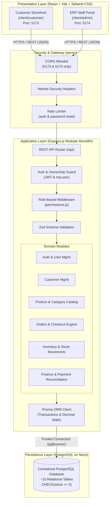
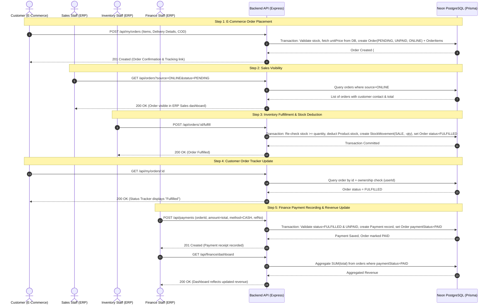
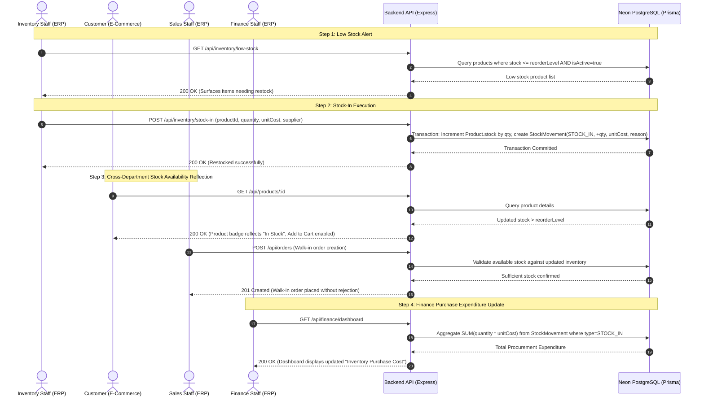

# 03 — Architecture & System Design

## 1. System Overview

VÉLORA is architected as a Client-Server Modular Monolith. The system integrates two frontends with a single unified backend API and one centralized PostgreSQL database hosted on Neon.

- **E-Commerce Customer Storefront (`client/customer`):** Public-facing portal for customers to browse luxury fragrances, manage their shopping carts, authenticate, checkout using Cash on Delivery (COD), and track order progress.
- **ERP Staff Portal (`client/admin`):** Role-gated internal operational portal serving four departments: Sales, Inventory & Warehouse, Finance, and Administration.
- **Backend API (`server`):** Node.js and Express.js REST API providing modular endpoints, JWT authentication, role authorization, Zod schema validation, and atomic transaction handling.
- **Database Layer (Neon PostgreSQL):** Single centralized relational database with pooled runtime connections and direct migration connections.

---

## 2. High-Level System Architecture Diagram

---

## 3. Department-to-Department Data Flow Diagrams

### 3.1 Workflow 1: Online Order to Payment (E-Commerce → Sales → Inventory → Finance)

---

### 3.2 Workflow 2: Restock and Cost Visibility (Inventory → E-Commerce, Sales, Finance)

